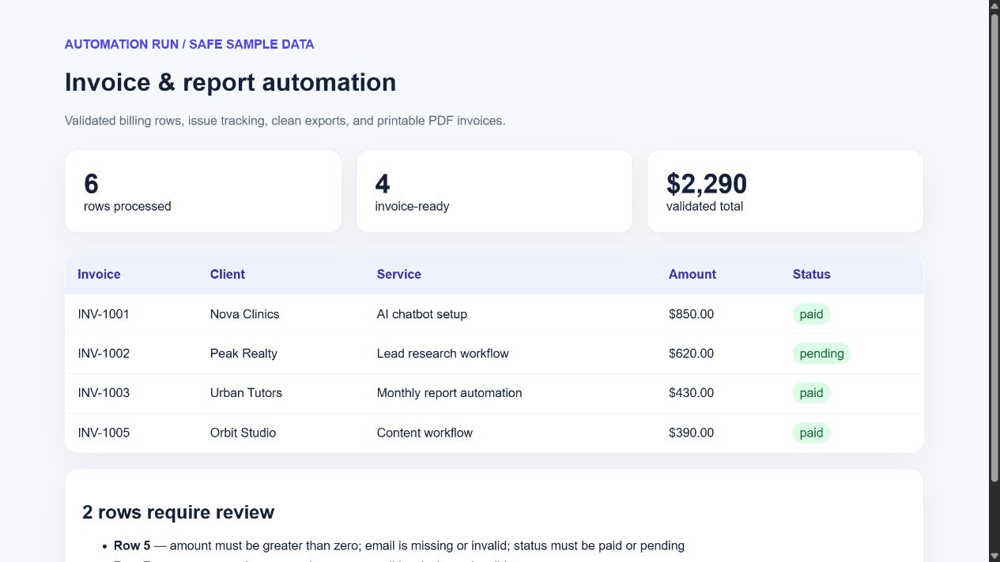

# Invoice & Report Automation

[](https://github.com/rongali-commits/invoice-report-automation/actions/workflows/ci.yml)
[Live application](https://rongali-commits.github.io/invoice-report-automation/) · [Portfolio](https://noerong.com/projects) · [Discuss a workflow](mailto:hello@noerong.com)

A client-style Python workflow that turns recurring billing CSV files into validated exports, an issue queue, run summaries, and printable PDF invoices.



## Business problem

Operations teams often receive inconsistent spreadsheets, repair rows manually, calculate totals, and create invoices one at a time. That makes a recurring process slow, difficult to audit, and easy to break.

This project demonstrates a safer workflow:

```text
CSV input -> schema checks -> row validation -> clean export + issue queue -> PDF invoices + run summary
```

## Demonstrated outcome

The included fictional dataset produces a repeatable result:

| Measure | Sample run |
| --- | ---: |
| Rows processed | 6 |
| Validated invoice rows | 4 |
| Rows flagged for review | 2 |
| Validated total | USD 2,290 |
| PDFs generated | 4 |

These are reproducible sample-run measurements, not claims about a real client engagement.
Validated rows pass the input checks and may still have pending payment status.

## What it delivers

- required-column and row-level validation;
- normalized email, status, and currency fields with explicit half-even cent rounding;
- clean CSV and separate issue queue;
- one printable PDF per valid invoice;
- JSON run summary and an HTML operations dashboard;
- automated tests for success and failure paths.

## Quick start

Requires Python 3.11 or newer.

```bash
python -m venv .venv
# Windows: .venv\Scripts\activate
# macOS/Linux: source .venv/bin/activate
python -m pip install -e ".[dev]"
invoice-automation sample_data/invoices.csv --output output
pytest
```

Open `output/dashboard.html` to inspect the run and `output/invoices/` for generated PDFs.
Choose a new or empty output directory for each run, for example `--output output-next`.
Non-empty directories are rejected so previous reports and invoice PDFs stay together.

## Expected input

See the [input and output contract](docs/input-contract.md) for the shared CSV,
duplicate-ID and money rules, filename safety, and edition-specific limits.

```csv
invoice_id,client,email,service,amount,status
INV-1001,Example Company,accounts@example.com,Monthly reporting,850,paid
```

Accepted statuses are `paid` and `pending`. Invalid rows are never silently discarded; they are written to `issues.csv` with a reason and source row number.

## Repository structure

```text
src/invoice_automation/   validation, output generation, and CLI
site/                     independently hosted browser edition
sample_data/              fictional billing records
tests/                    Python and browser tests with shared contract fixtures
docs/                     verified screenshot
```

## Production handoff

For a real engagement I would adapt column mappings, invoice branding, currency and tax rules, delivery channels, and storage to the client's process. Email or cloud uploads would be added behind explicit credentials and an audit log. No client data, secrets, or third-party API keys are included here.

## Contributing and support

See [CONTRIBUTING.md](CONTRIBUTING.md) for a working setup, sample expectations and
checks for the Python and browser editions. Report reproducible problems through
[GitHub issues](https://github.com/rongali-commits/invoice-report-automation/issues)
using a small fictional dataset.

Try the live browser workflow with fictional billing rows and share which import,
exception or export step slows you down in
[GitHub issues](https://github.com/rongali-commits/invoice-report-automation/issues).
Include expected and actual results so the workflow can be improved and verified.

## License

MIT — see [LICENSE](LICENSE).
